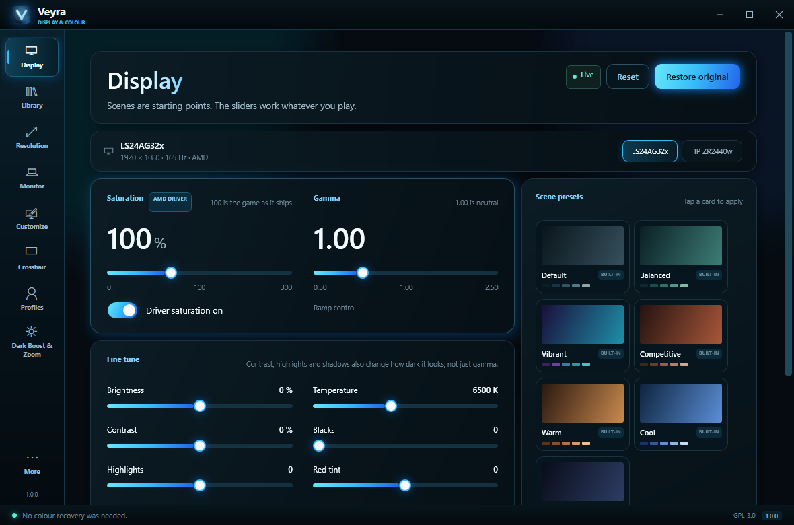

<div align="center">


# Veyra

**Display and colour control for Windows, with a way back.**

Per-display GPU driver saturation, live Windows colour controls, guarded display modes,
a click-through crosshair and global hotkeys. Veyra is a calibration tool, not a game
booster: it changes how a display looks, never how a game performs, and it does not inject
into games or touch anti-cheat systems.

[](https://github.com/zenou101/veyra/actions/workflows/build.yml)
[](LICENSE)


[Website](https://zenou101.github.io/veyra/) · [Overview](#overview) · [Colour support](#colour-support) · [Build and run](#build-and-run) · [Limitations](#known-limitations)

</div>

## Download

[**Veyra website**](https://zenou101.github.io/veyra/) · [Portable ZIP](https://github.com/zenou101/veyra/releases/download/v1.0.0/Veyra-Portable-1.0.0-x64.zip) · [Installer MSI](https://github.com/zenou101/veyra/releases/download/v1.0.0/Veyra-Setup-1.0.0-x64.msi)

Both builds are self-contained Windows x64. The installer is per-user, adds Start-menu and desktop
shortcuts, and needs no administrator rights. Release binaries are unsigned and are published on GitHub Releases, not in the source tree.

| Display |
| :---: |
|  |

## Overview

Veyra is a focused WPF app for Windows 10 x64. It detects the complete display setup,
applies changes only when the driver accepts them, and keeps an exact snapshot so every
change can be undone. A compact navigation sidebar keeps the six main pages within reach, with
startup, hotkeys and licence details on **More**:

- **Display** — driver saturation and Windows gamma side by side, brightness, contrast,
  temperature, blacks, highlights and red tint in one fine-tuning grid, with saved looks you
  can apply or delete.
- **Resolution** — monitor modes and refresh rates, applied with a 15-second confirmation and
  an out-of-process rollback guard.
- **Monitor** — the monitor's own DDC/CI settings: brightness, contrast and low blue light
  where the display exposes them, with a one-click restore.
- **Customize** — Default or Slate panels, panel opacity, a background picture, soft or petal
  backdrop, and a live text-contrast check.
- **Crosshair** — a click-through layered window drawn by Windows, with no injection or hooks.
- **Profiles** — named game profiles that store a look and apply it on request.
- **More** — startup and close behaviour, global hotkeys, provider status, licence and data
  location.

The layout is new; the identity is the original Veyra one. The dark navy surfaces, cyan
accents, glass cards, gradient titles, rounded controls, slider and toggle styling, hover
glows and ambient background light all come from the original theme.

## Colour support

| Vendor | Driver saturation | Windows ramp controls | Verification |
| --- | --- | --- | --- |
| **AMD Radeon** | ADL2, per display, 0–300 % on the tested driver | Yes | **Verified** on an RX 7800 XT, driver 32.0.32029.2010 |
| **NVIDIA** | Digital Vibrance through NVAPI, driver-reported range | Yes | **Implemented; not hardware-tested** (no NVIDIA GPU in the test machine) |
| **Intel** | Not implemented | Yes | **Limited**: brightness, contrast, gamma and temperature only |

Saturation changes the GPU's output stage, not a gamma curve, so it also applies where a
gamma-ramp effect would not. Veyra reads the range from the active driver and never assumes
one vendor's range for another.

**Every write is reversible.** Veyra captures the original ramp and the exact native driver
value before the first change, persists them, and restores them on request, on exit, or after
a crash or forced termination. A second process, `Veyra.DisplayGuard.exe`, handles display-mode
rollback if the app stops responding.

### Verified on the test machine

| Check | Result |
| --- | --- |
| Debug and Release builds (win-x64) | pass |
| Unit tests (Core, Storage, Display, Games) | **56 passed, 0 failed** |
| App launch, navigation and all six pages | verified; screenshots above |
| Windows gamma ramp write/read | accepted; ramp readback changed and restored |
| AMD ADL2 saturation write/read | **verified 0–300 %**: 100 → 150 → 100 through the slider, bypass and restore |
| AMD driver saturation crash recovery | **verified**: 170 % survived a killed process and was restored to 100 % on the next launch |
| NVIDIA NVAPI path | exercised with a mock NVAPI DLL; a real NVIDIA driver is still required |
| Display-mode guard | verified: an unconfirmed 165 → 60 Hz change was reverted by the guard timeout |

The test machine is an AMD Radeon RX 7800 XT, Ryzen 7 5700X, 16 GB RAM, Windows 10 22H2 x64.
See [COMPATIBILITY.md](COMPATIBILITY.md) for the full evidence table.

## Build and run

**Requirements**

- Windows 10 22H2 or later, x64.
- [.NET SDK 10](https://dotnet.microsoft.com/download) to build from source.
- No Visual Studio requirement.

```powershell
git clone https://github.com/zenou101/veyra.git
cd veyra
dotnet build Veyra.slnx -c Release
dotnet run --project src/Veyra.UI/Veyra.UI.csproj
```

Build output and local packaging are ignored by Git. To make a self-contained portable ZIP
and checksums in `dist/`, run:

```powershell
pwsh ./scripts/package.ps1
```

The packaging script also places the recovery guard beside the app. Settings, presets,
snapshots and logs are stored under `%LOCALAPPDATA%\Veyra`. Nothing is sent anywhere.

## Design principles

- **No hidden state.** Capabilities and limitations come from the driver, not hard-coded guesses.
- **No unguarded changes.** Colour originals are persisted before writes; display changes require
  confirmation and a separate rollback process.
- **No game interference.** No process injection, no hooks, no anti-cheat interaction. The crosshair
  is a normal click-through desktop window.
- **No invented numbers.** FPS and frame time are deliberately not shown; GPU utilisation is
  system-wide, not per process.
- **Fail visibly.** If a driver refuses a write or the guard is missing, the UI says so and refuses
  the change rather than pretending it worked.

## Project layout

```
src/Veyra.UI/           WPF shell, pages, tray and hotkeys
src/Veyra.Colour/       Windows ramp and AMD/NVIDIA driver colour paths
src/Veyra.Display/      Display enumeration, modes and guard sessions
src/Veyra.Storage/      SQLite migrations, repositories and atomic JSON stores
src/Veyra.Games/        Profile model and matching engine
src/Veyra.Telemetry/    System-wide GPU, CPU and memory sampling
src/Veyra.Overlay/      Click-through crosshair window
src/Veyra.DisplayGuard/ Separately hosted display rollback watchdog
tests/                  xUnit test projects
```

More detail: [ARCHITECTURE.md](ARCHITECTURE.md), [BUILDING.md](BUILDING.md),
[COMPATIBILITY.md](COMPATIBILITY.md), [CHANGELOG.md](CHANGELOG.md).

## Known limitations

- Release binaries are **unsigned**; Windows SmartScreen will warn about them.
  The source tree contains no release binary.
- **NVIDIA** support is implemented but was not tested on NVIDIA hardware. **Intel** saturation is
  not implemented; Intel users get the Windows ramp controls only.
- HDR capability is read and displayed, but HDR switching is not offered.
- Windows 11, hybrid laptops and multi-GPU systems are not verified.
- Monitor controls depend on DDC/CI support in the display and adapter. Veyra disables a control
  when the monitor refuses it rather than showing a slider that cannot work.
- A crosshair cannot be guaranteed above every exclusive-fullscreen game.
- The display-change dialog's Keep/Revert buttons were not separately clicked through in the
  recorded test; the guard's own timeout rollback was verified.
- Driver colour can be overwritten by Radeon Software or another third-party tool after Veyra
  applies it. Veyra restores the value it captured, not a later external change.

## Contributing

Bug reports and focused pull requests are welcome. Please read [CONTRIBUTING.md](CONTRIBUTING.md)
and include the Windows version, GPU, driver version, display layout and relevant log.

## Licence

Veyra is free software licensed under the **GNU General Public License v3.0 or later**.
See [LICENSE](LICENSE).

Copyright © 2026 zenou101.

Veyra is an independent project and is not affiliated with AMD, NVIDIA, Intel or Microsoft.
